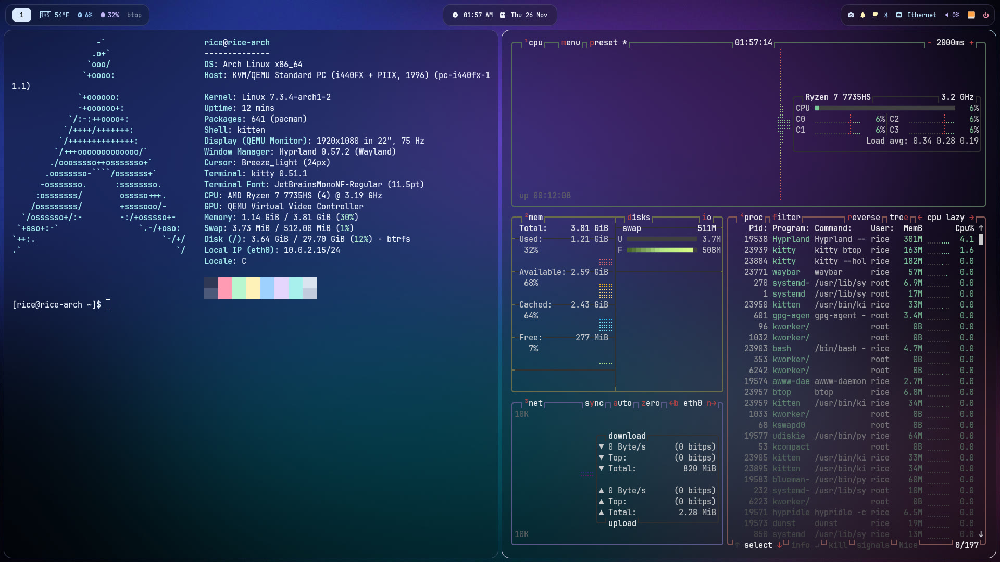
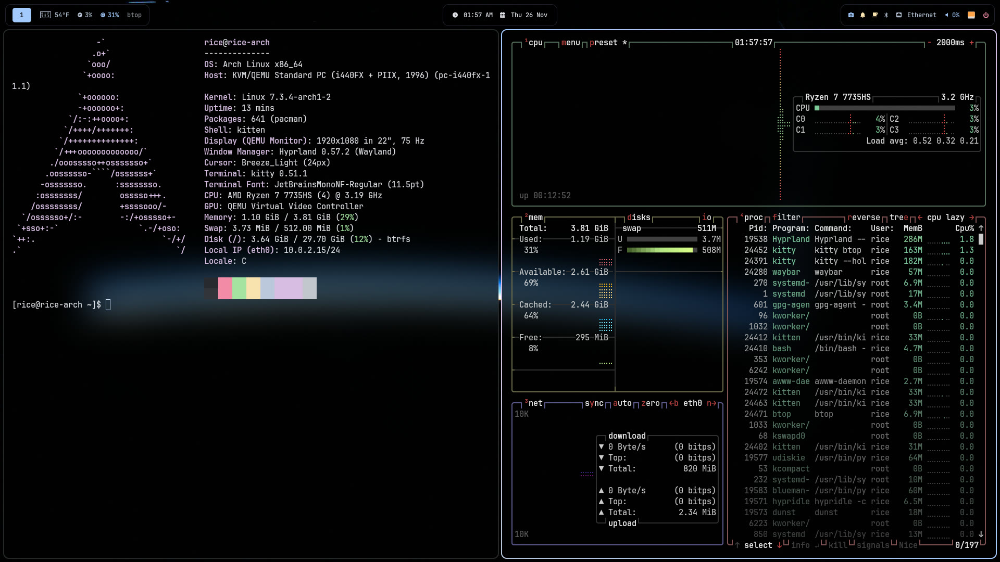

<h1 align="center">wire</h1>

<p align="center">
  A complete Hyprland desktop in one command.<br>
  Black, glassy, minimal. Four looks, one key to switch.
</p>

<p align="center">
  
  
  
  
  
  
</p>

<p align="center">
  
</p>

## Install

```sh
git clone https://github.com/dork40/hyprland-rice.git ~/hyprland-rice 2>/dev/null || git -C ~/hyprland-rice pull
~/hyprland-rice/install.sh
```

Same lines to update. It installs Hyprland and everything the desktop uses for your distro, backs
up your old configs to `~/.config-rice-backup-<date>`, sets up the login screen, and asks two
things: laptop or PC, and which graphics card. Reboot, pick **Hyprland** at the login screen, done.

## Looks

`Super+Shift+R` opens the Wardrobe. Pick a look and the whole desktop changes together: bar,
windows, launcher, notifications, terminal colours and wallpaper.

<table>
  <tr>
    <td width="50%"><br><b>noir</b> · Catppuccin accents on black, floating rounded windows. The default.</td>
    <td width="50%"><br><b>liquid</b> · frosted glass, see-through panels, heavy blur.</td>
  </tr>
  <tr>
    <td><br><b>mono</b> · pure greyscale, flat, no animations. Instant.</td>
    <td><br><b>aurora</b> · colours pulled from the wallpaper, on a black base.</td>
  </tr>
</table>

<p align="center"></p>

## What's in it

|  |  |
|---|---|
| **Wardrobe** `Super+Shift+R` | Switch the whole look in one go |
| **Displays** `Super+Shift+D` | Resolution, refresh rate, scale, rotation, drag to arrange screens. A bad setting undoes itself after 15 s |
| **Welcome** `Super+F1` | A first-login guide for people new to Hyprland |
| **Cheat sheet** `Super+/` | Every shortcut, searchable |
| **AI keys** `Super+Shift+Ctrl+A` | One key to open your AI assistant: Claude Code, Codex, Gemini, Ollama, a web chat, and more |
| **The basics, done** | Waybar, launcher, notifications, kitty, power menu, volume and brightness pop-ups, clipboard history, emoji picker, screenshots, screen recording, copy text from the screen |

Want moving wallpapers? [Mural](https://github.com/dork40/mural) works with every look here: animated ones that take
their colours from the current look, and free 4K videos of Earth at night from the Space Station that
suit the dark styles. It can put them on the login screen too.

## Keys

| Key | |
|---|---|
| `Super+Shift+R` | Wardrobe |
| `Super+W` | Wallpapers for the current look |
| `Super+Shift+D` | Displays |
| `Super+F1` | Welcome |
| `Super+/` | Cheat sheet |
| `Super+Shift+Ctrl+A` | Open your AI |
| `` Super+Shift+Ctrl+` `` | Choose which AI is yours |
| `Super+Shift+Ctrl+1` … `0` | One key per AI |

## Tested on

Every release is installed on clean virtual machines, the way a new user would: a fresh image,
the install lines above, then checks that Hyprland, every tool, the fonts, the login session and
the config all work.

| Distro | Result |
|---|---|
| Arch Linux | **Pass** · `yay` is set up automatically for the AUR bits |
| Fedora 45 | **Pass** · Hyprland from a COPR. SwayOSD isn't packaged, so volume/brightness show plain notifications |
| Bazzite (Fedora 45) | **Pass** · install, reboot, install again |
| Ubuntu 26.04 | **Pass** · Hyprland from the PPA, `awww` built from source |
| Ubuntu 24.04 | **Partial** · the desktop works, but it's too old for the Wardrobe/Welcome windows and animated wallpaper switching |

Last run: November 2026, Hyprland 0.57.2. The harness is in [`tests/vm`](tests/vm) if you want to
run it yourself.

<details>
<summary><b>How each distro gets Hyprland</b></summary>

| Distro | How |
|---|---|
| **Arch** and Arch-based | `pacman -Syu`, then the repos. AUR packages (like `wlogout`) through `yay` or `paru`; the installer sets up [`yay`](https://github.com/Jguer/yay) if you have neither |
| **Fedora** | `dnf` plus a Hyprland COPR, because Fedora's own Hyprland stopped at 0.45. It uses the first of [`sdegler/hyprland`](https://copr.fedorainfracloud.org/coprs/sdegler/hyprland/), [`pm4rcin/Hyprland`](https://copr.fedorainfracloud.org/coprs/pm4rcin/Hyprland/) or `solopasha/hyprland` that has your Fedora version |
| **Bazzite / Fedora Atomic** | `rpm-ostree` with the same COPR. Run the installer, reboot, run it once more. Bazzite's Xwayland conflicts with Hyprland's package, so it's swapped for Fedora's (undo with `rpm-ostree rollback`). The NVIDIA driver and login screen are left alone |
| **Ubuntu**, Mint, Pop!_OS | `apt`, plus the [Hyprland PPA](https://launchpad.net/~cppiber/+archive/ubuntu/hyprland) (kept by Hyprland team member Constantin Piber) before 26.10 |
| **Debian** | `apt` from your release. Hyprland 0.56+ is only in testing/unstable |

It skips what you already have and lists anything your distro doesn't ship at the end. If
Hyprland itself can't be installed it says so and stops, instead of pretending it finished.
The config uses Hyprland's Lua format, so it needs 0.56 or newer.

</details>

<details>
<summary><b>Laptop or PC</b></summary>

The installer guesses from whether there's a battery.

- **Laptop:** battery in the bar, brightness keys, low-battery warnings at 15% and 5%.
- **PC:** an optional max-performance mode (`rice-max-performance` service): CPU governor on
  `performance`, GPU clocks pinned high, every PWM fan at 100%. Loud on purpose. Turn it off with
  `sudo systemctl disable --now rice-max-performance`.

</details>

<details>
<summary><b>Graphics cards</b></summary>

- **NVIDIA:** the open driver, kernel modesetting and suspend services (reboot once). NVIDIA-only
  machines also get the Wayland settings Hyprland needs. GTX 10xx and older need
  `nvidia-580xx-dkms` from the AUR, by hand. Bazzite already has its driver and is left alone.
- **AMD / Intel:** Mesa Vulkan and video acceleration.
- **Hybrid:** both, with the integrated GPU driving the screen. Run a game on the NVIDIA card with
  `__NV_PRIME_RENDER_OFFLOAD=1 __GLX_VENDOR_LIBRARY_NAME=nvidia <program>`.

</details>

<details>
<summary><b>AI keys in detail</b></summary>

`` Super+Shift+Ctrl+` `` shows every assistant with a status dot (● ready, ◐ installed but not
signed in, ○ not installed). Pick one and `Super+Shift+Ctrl+A` opens it, or jumps to it if it's
already open. `Super+Shift+Ctrl+1`…`0` give one key each to Claude Code, Codex, Gemini CLI,
OpenCode, Aider, Ollama, ChatGPT, Claude.ai, Gemini and Perplexity; the first press asks which AI
you want on that key. Terminal AIs open in their own kitty window (with the install command if
they're missing), web ones as app windows.

**Yolo mode** (off by default, toggled from the bottom of the menu) starts terminal AIs without
their "may I edit/run this?" prompts. It lets the AI change or delete anything your user can.

</details>

<details>
<summary><b>Notes</b></summary>

- Screens are set in Displays and saved to `~/.config/hypr/monitors.lua`; until then Hyprland
  auto-detects them.
- Weather uses a location guessed from your IP. Set `WEATHER_LOCATION="City,State"` to pin it.
- JetBrainsMono Nerd Font, Breeze cursor, Papirus-Dark icons.
- Looks are defined in `config/rices/wardrobe.py` and `config/rices/base/`. Files like
  `waybar/style.css` are generated on every switch, so edit the base files instead.
- Scripted installs: `RICE_EDITION=laptop|pc`, `RICE_GPU=nvidia|amd|intel|hybrid-amd|hybrid-intel|other`,
  `RICE_MAXPERF=0|1`.

</details>

## License

MIT (see `LICENSE`). Wallpapers are NASA public-domain photos, credited in `wallpapers/CREDITS.md`.
