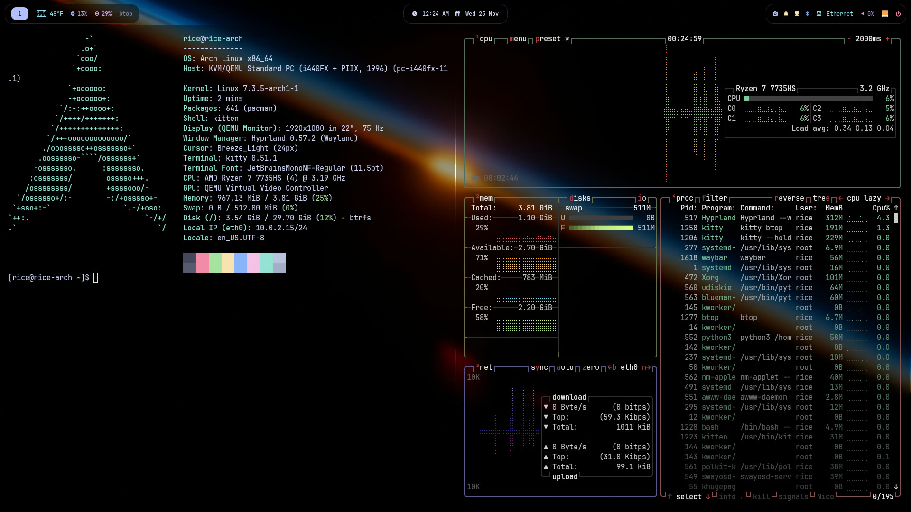
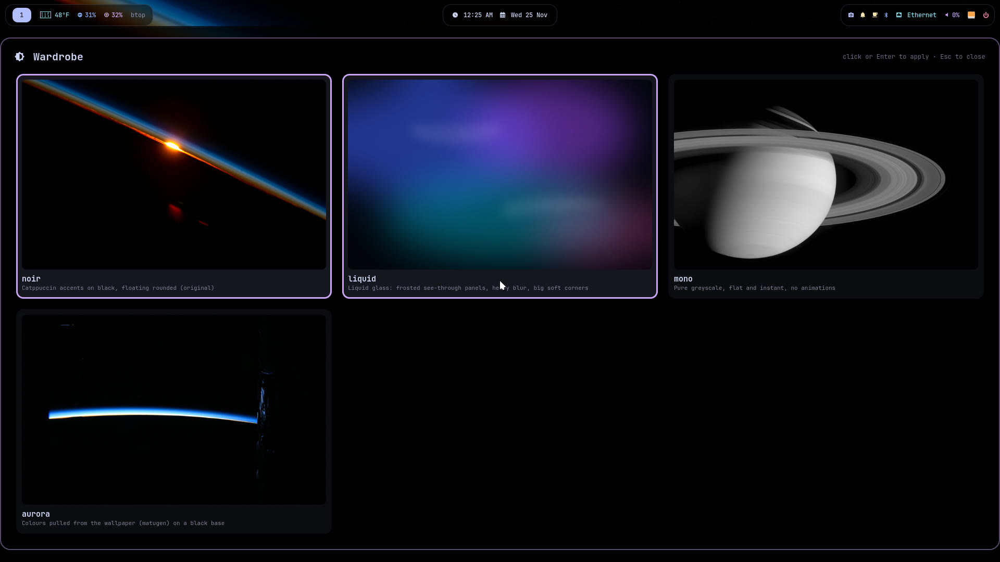
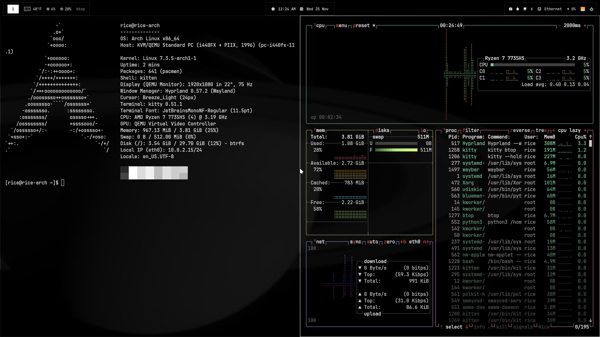

<h1 align="center">hyprland-rice</h1>

<p align="center">
  A complete Hyprland desktop that installs with one command.<br>
  Black, glassy and minimal, with four styles you can swap with one key.
</p>

<p align="center">
  
  
  
  
  
  
</p>



```sh
git clone https://github.com/dork40/hyprland-rice.git ~/hyprland-rice && cd ~/hyprland-rice && ./install.sh
```

That's the whole install. It pulls in Hyprland and every dependency for your distro, backs up your old configs, sets up the login screen and asks two questions: laptop or PC, and which graphics card (NVIDIA, AMD, Intel or hybrid).

## Styles

`Super+Shift+R` opens the Wardrobe. Pick a style and the whole desktop changes at once: bar, windows, launcher, notifications, terminal colours and wallpaper.



| | |
|---|---|
|  **noir**: Catppuccin accents on black, floating rounded windows (default) |  **liquid**: frosted glass, see-through panels, heavy blur |
|  **mono**: pure greyscale, flat and instant, no animations |  **aurora**: colours pulled from the wallpaper on a black base |

Wallpapers are public-domain NASA photos (credits in `wallpapers/CREDITS.md`).

## What you get

- **A finished desktop**: Waybar, launcher, dunst notifications, kitty, a power menu, volume and brightness pop-ups, clipboard history, emoji picker, screenshots, screen recording and a copy-text-from-screen (OCR) shortcut.
- **Wardrobe** (`Super+Shift+R`): the style switcher above.
- **Displays app** (`Super+Shift+D`): resolution, refresh rate, scale, rotation and drag-to-arrange for several monitors, with a "keep these settings?" countdown so a bad setting can't lock you out.
- **AI switcher** (`Super+Shift+Ctrl+...`): one key to jump to Claude Code, Codex, Gemini, OpenCode, Aider, Ollama or a web chat.
- **Welcome window** (`Super+F1`): a first-login guide, so someone new to Hyprland knows how to open apps, move windows and change the look.

## Tested on

The installer is tested on clean virtual machines: a fresh cloud image with nothing installed, then the install line above, exactly as a new user would run it. The test then checks that Hyprland, every tool the rice uses, the fonts, the login session and the config are all in place, and that Hyprland accepts the config.

| Distro | Version | Result |
|---|---|---|
| Arch Linux | rolling | **Pass**: Hyprland 0.57.2 and everything else, `yay` set up automatically for the AUR |
| Fedora | 45 | **Pass**: Hyprland from the COPR. SwayOSD isn't packaged, so the volume/brightness keys show plain notifications |
| Bazzite | stable (Fedora 45 base) | **Pass**: install, reboot, install again. Xwayland is swapped automatically |
| Ubuntu | 26.04 LTS | **Pass**: Hyprland from the PPA, `awww` built from source (adds a few minutes) |
| Ubuntu | 24.04 LTS | **Partial**: Hyprland and the desktop work, but 24.04 is too old for the Wardrobe/Welcome windows (no gtk4-layer-shell) and wallpapers (Rust too old to build `awww`) |

Last run: November 2026, Hyprland 0.57.2.

The test harness is in [`tests/vm`](tests/vm), so anyone can re-run it (`tests/vm/images.sh`, then `tests/vm/test.sh <distro> <port>`).

## Install

```sh
git clone https://github.com/dork40/hyprland-rice.git ~/hyprland-rice 2>/dev/null || git -C ~/hyprland-rice pull
cd ~/hyprland-rice
./install.sh
```

Paste all three lines (this version also works for updating). `./install.sh` installs everything: the packages (it asks for your password), the configs, the wallpapers and the apps below. The block works the first time and every time after: it downloads the rice, or updates it if you already have it. The installer also updates itself to the latest version before it starts.

The installer asks two questions (laptop or PC, and which graphics card) and then does everything. There is nothing else to pick through. It checks all the packages in one go and **skips what you already have** (already running Hyprland but no wofi? It installs just wofi, and the rest). It also installs **SDDM** as your login screen and sets it to start Hyprland. It installs only what the rice itself uses: Hyprland and its helpers (hypridle, hyprpaper, hyprpicker), Waybar, wofi, dunst, kitty, swayosd, wlogout, thunar (files), clipboard history, screenshots and screen recording, media keys, the volume/network/Bluetooth applets, the starship prompt and the JetBrainsMono Nerd Font. It does not install anyone's personal apps.

Existing configs are backed up to `~/.config-rice-backup-<date>` before anything is overwritten.

## Getting into Hyprland

After the install (and the reboot it asks for), the login screen starts Hyprland by default. If it still offers your old desktop (it says something like "Plasma (Wayland)"), click that session label, usually at the bottom-left of the screen, choose **Hyprland**, and log in. If there is no session menu, press `Ctrl+Alt+F3`, log in as text and type `Hyprland`.

On Bazzite and other immutable Fedora systems: run the installer, reboot, and run it once more.

## AI switcher

- **`Super+Shift+Ctrl+` ` `` ` `** (the backtick key) **switches agent**: a menu shows every AI with a status dot (● ready, ◐ installed but not signed in yet, ○ not installed). Pick one and it becomes your AI and opens.
- **`Super+Shift+Ctrl+A`** opens your selected AI, or jumps to its window if it is already open. If you haven't picked one yet it asks first.
- **`Super+Shift+Ctrl+1` to `0`** are one-key shortcuts, one per AI.

**Yolo mode** (off by default) starts your terminal AI without the "may I edit this file / run this command?" prompts. Turn it on or off from the bottom line of the switch-agent menu, or run `ai.py yolo on` / `ai.py yolo off`. It uses each tool's own flag: Claude Code `--dangerously-skip-permissions`, Codex `--dangerously-bypass-approvals-and-sandbox`, Gemini CLI and Qwen Code `--yolo`, Aider `--yes-always`, GitHub Copilot CLI `--allow-all-tools`, Goose `GOOSE_MODE=auto`. **It lets the AI change or delete anything your user can, so only use it where you accept that.** Web AIs and OpenCode/Ollama have no such flag. A command in `ai-overrides.json` always wins over yolo mode.

Sign-in status is a best guess from each tool's login files or API-key variables. Web AIs use whatever your browser is signed in to.

One key per assistant. **The first time you press a key it asks "Which AI do you want?"** (the suggested one is on top) and remembers your answer. After that the key jumps to that AI if it is already open, or opens it. Suggested defaults:

| Key (with `Super+Shift+Ctrl`) | AI |
|---|---|
| `1` | Claude Code |
| `2` | OpenAI Codex |
| `3` | Gemini CLI |
| `4` | OpenCode |
| `5` | Aider |
| `6` | Ollama (local models) |
| `7` | ChatGPT (web) |
| `8` | Claude.ai (web) |
| `9` | Gemini (web) |
| `0` | Perplexity (web) |
| other AIs | Grok, Copilot, Le Chat, DeepSeek, Qwen Code, Goose and GitHub Copilot CLI are in the switch-agent menu |

Terminal AIs open in their own kitty window. If one isn't installed, the window shows the install command and offers to run it. Web AIs open as app windows in Chrome/Chromium (or your default browser). `ai.py list` shows what is installed. To change which AI a key opens later, use the "Change which AI a key opens" line in the `Super+Shift+Ctrl+A`-menu (`ai.py pick`) or run `ai.py assign` (answers are kept in `~/.config/hypr/ai-slots.json`). To change a command, create `~/.config/hypr/ai-overrides.json`, for example `{"claude": "claude --model opus"}`.

## Welcome window

On your first login a **Welcome** window opens with the basics: how to open apps, close and move windows, switch workspaces, take screenshots, and buttons for changing the style, wallpaper and screens. Reopen it any time with `Super+F1`.

## Displays app

`Super+Shift+D` (or "Displays" in your app launcher) opens a screen settings window:

- pick **resolution**, **refresh rate**, **scale** and **rotation** for each monitor
- **drag the screens** to arrange them side by side (they snap together), or use the ◀ ▶ ▲ ▼ buttons to place one next to another
- **mirror** one screen onto another, or switch a screen off
- **Apply** shows a 15-second "keep these settings?" countdown and reverts by itself if you don't confirm, so a bad setting can't lock you out
- **Keep** saves the layout to `~/.config/hypr/monitors.lua`, which Hyprland loads at every start

## Supported distros

`install.sh` detects your distro and installs the dependencies with its package manager:

| Distro | How |
|---|---|
| **Arch** (and Arch-based) | Updates the system first (`pacman -Syu`), then installs from the repos. AUR packages (such as `wlogout`) go through `yay` or `paru`; on a fresh Arch with neither, the installer sets up [`yay`](https://github.com/Jguer/yay) for you |
| **Fedora** | `dnf`, plus a Hyprland COPR because Fedora's own Hyprland stopped at 0.45. It uses the first of [`sdegler/hyprland`](https://copr.fedorainfracloud.org/coprs/sdegler/hyprland/), [`pm4rcin/Hyprland`](https://copr.fedorainfracloud.org/coprs/pm4rcin/Hyprland/) or `solopasha/hyprland` that has packages for your Fedora version |
| **Bazzite / Fedora Atomic** (Silverblue, Kinoite, Aurora) | `rpm-ostree` layering with the same COPR. Run `./install.sh`, reboot, then run `./install.sh` once more to finish the last pieces (that's the flow the VM test checks). The NVIDIA driver and your login screen are left alone. Bazzite's own Xwayland conflicts with Hyprland's package, so the installer swaps it for Fedora's (undo with `rpm-ostree rollback`) |
| **Ubuntu** (and Mint, Pop!_OS) | `apt`. If your Ubuntu's Hyprland is missing or older than 0.56 (anything before 26.10), the installer adds the [Hyprland PPA](https://launchpad.net/~cppiber/+archive/ubuntu/hyprland), maintained by Hyprland team member Constantin Piber |
| **Debian** | `apt`, from your release. Hyprland 0.56+ is only in testing/unstable |

Anything your distro doesn't ship is listed at the end. If Hyprland itself could not be installed, the installer says so plainly and stops instead of saying "Done". The JetBrainsMono Nerd Font and the `starship` prompt come from their GitHub releases on non-Arch systems. Where `awww` (wallpapers) isn't packaged, `swww` (its previous name) is used instead.

**Note:** the config uses Hyprland's **Lua config format** (Hyprland 0.56 and newer). The installer gets you a new enough Hyprland on every distro in the table above except Debian stable.

## Keys

| Key | Action |
|---|---|
| `Super+Shift+R` | Wardrobe: pick a style |
| `Super+W` | Wallpapers for the current style |
| `Super+Shift+D` | Displays: resolution, refresh rate, scale, rotation, multi-monitor layout |
| `Super+Shift+Ctrl+1` to `0` | AI switcher: jump to an AI assistant (see below) |
| `Super+Shift+Ctrl+` + `` ` `` | Switch agent: pick which AI is yours |
| `Super+Shift+Ctrl+A` | Open your selected AI |
| `Super+F1` | Welcome window: how to open apps, move windows, change styles |
| `Super+/` | Searchable cheat sheet of every shortcut |

## Laptop or PC

The installer asks which one you have and suggests the answer by looking for a battery.

- **Laptop:** adds a battery module in the bar, screen brightness keys and low-battery warnings (15% and 5%).
- **PC:** adds an optional **max-performance mode** that is on by default if you accept it. A systemd service (`rice-max-performance`) sets this at every boot:
  - CPU governor to `performance` with boost on
  - AMD GPU clocks pinned high, Intel GPU minimum clock raised to its maximum, NVIDIA power limit raised to its maximum with the graphics clock locked at its top speed
  - every motherboard and GPU PWM fan header at 100%

Fans at 100% are loud on purpose. Boards or GPUs that don't expose PWM fan control are skipped, and NVIDIA graphics-card fans can't be set from Wayland, so they keep their automatic curve. Turn it off any time:

```sh
sudo systemctl disable --now rice-max-performance   # back to automatic fans and normal governors
```

For scripted installs, skip the questions with `RICE_EDITION=laptop|pc`, `RICE_GPU=nvidia|amd|intel|hybrid-amd|hybrid-intel|other` and `RICE_MAXPERF=0|1`.

## Graphics cards

- **NVIDIA:** installs the open NVIDIA driver, turns on kernel modesetting and the suspend/resume services (reboot once afterwards). On an NVIDIA-only machine it also writes `~/.config/hypr/nvidia.lua` with the Wayland settings Hyprland needs. Older cards (GTX 10xx and before) need the AUR driver `nvidia-580xx-dkms`; install it by hand. On Bazzite/Fedora Atomic the image already has the driver, so it is left alone.
- **AMD and Intel:** installs the Mesa Vulkan and video-acceleration packages for your distro (skipped if you already have them).
- **Hybrid (NVIDIA + AMD or Intel):** installs both sets and leaves the environment alone so the integrated GPU keeps driving the screen. Run a game on the NVIDIA GPU with `__NV_PRIME_RENDER_OFFLOAD=1 __GLX_VENDOR_LIBRARY_NAME=nvidia <program>`.
- The bar's GPU module shows usage and temperature for AMD and NVIDIA (Intel shows no usage figure).

## Notes

- `config/hypr/hyprland.lua` uses the **Lua config** of recent Hyprland (written against 0.56). Screens are managed by the Displays app (`Super+Shift+D`); until you save a layout, Hyprland auto-detects them.
- Weather defaults to a location guessed from your IP. Set `WEATHER_LOCATION="City,State"` to pin it.
- Fonts: JetBrainsMono Nerd Font. Cursor: Breeze_Light. Icons: Papirus-Dark.
- Edit styles in `config/rices/wardrobe.py` (palette + Hyprland values per style) and the shared base files in `config/rices/base/`. Do not edit the generated `waybar/style.css`, `wofi/style.css`, etc.: they are rewritten on every switch.

## License

Configs and scripts: MIT (see `LICENSE`). Wallpapers: NASA public-domain photos, see `wallpapers/CREDITS.md`.
